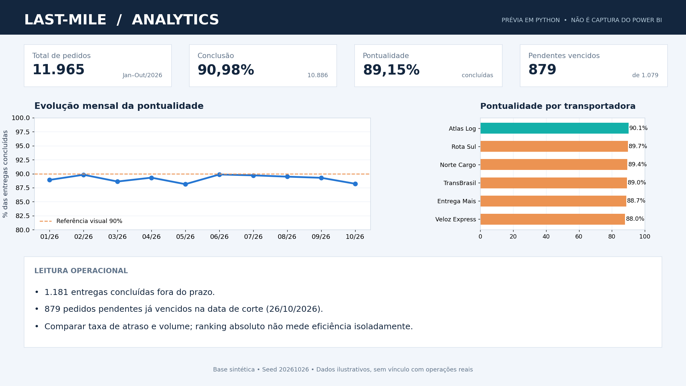
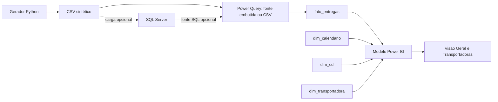

# Last-Mile Analytics

**Análise de desempenho de entregas com Power BI, SQL Server e Python.** Projeto de portfólio com dados **100% sintéticos e reproduzíveis**, criado para investigar pontualidade, pedidos vencidos e desempenho de transportadoras e centros de distribuição.



> **Sobre a imagem:** a prévia acima foi gerada em Python com os dados deste repositório; **não é uma captura do Power BI**. A [referência visual aprovada para o layout](docs/referencia_visual_opcao_1.png) também é conceitual. O relatório editável e os cálculos estão no projeto PBIP.

## O que o projeto responde

- Qual a **pontualidade das entregas concluídas** e como ela evolui mês a mês?
- Quantos pedidos **permanecem pendentes após o prazo previsto**?
- Quais transportadoras merecem atenção quando se consideram **taxa de atraso e volume de entregas**?
- Como os indicadores mudam ao filtrar **período de coleta, transportadora e centro de distribuição**?

## Resultados da base sintética

| Indicador | Total da amostra |
|---|---:|
| Pedidos | **11.965** |
| Entregas concluídas | **10.886** |
| Entregas no prazo | **9.705** |
| Pontualidade das concluídas | **89,15%** |
| Entregas concluídas em atraso | **1.181** |
| Pedidos pendentes | **1.079** |
| Pendentes com prazo vencido | **879** |

A data de corte da demonstração é **26/10/2026**. Os números não representam uma empresa ou operação real. A referência de 90% exibida no gráfico é **ilustrativa**, não um SLA contratado.

## Páginas do Power BI

| Página | Para que serve |
|---|---|
| **Visão Geral** | Resumo operacional, evolução mensal da pontualidade, análise comparativa e destaques do período |
| **Transportadoras** | Indicadores próprios de desempenho, série temporal, comparação entre prestadores e pontos de atenção |

O relatório utiliza navegação lateral e filtros de **período, transportadora e CD**, compartilhados entre as páginas. A análise temporal está vinculada à **data de coleta**, não à data de entrega.

## Como abrir sem banco de dados

**Pré-requisito:** Power BI Desktop com suporte a projetos PBIP / TMDL.

1. Clique em **Code → Download ZIP** no GitHub ou clone este repositório.
2. Extraia a pasta e abra [`powerbi/projetogit.pbip`](powerbi/projetogit.pbip) no **Power BI Desktop**.
3. No menu **Transformar dados → Gerenciar parâmetros**, verifique que `ModoFonte` está definido como **`Embutido`** (valor padrão).
4. Clique em **Atualizar**, se solicitado. No modo embutido, **não é necessário SQL Server nem caminho de arquivo local**.
5. Confirme o total de **11.965 pedidos** e teste os filtros e a navegação. No modo de edição, botões de navegação podem exigir **Ctrl + clique**.

O projeto armazena os dados sintéticos comprimidos na consulta Power Query, e o mesmo CSV está disponível em `data/`. Dessa forma, é possível explorar o relatório sem depender de `localhost`, credenciais ou serviços externos.

### Fontes disponíveis

| `ModoFonte` | Funcionamento | O que configurar |
|---|---|---|
| **Embutido** | Base demonstrativa no próprio modelo | Nada; é o padrão |
| **CSV** | Lê `lastmile_sintetico.csv` | `CaminhoCSV` com o caminho absoluto no seu PC |
| **SQL** | Lê `dbo.fato_entregas` | `ServidorSQL` e `BancoSQL`, após executar a carga opcional |

Os caminhos e servidor nos parâmetros CSV e SQL são **exemplos para configuração manual**; não são necessários para abrir o relatório no modo padrão.

## Reproduzir os dados e os testes

Requisito para os comandos abaixo: **Python 3.10+**. O gerador usa apenas a biblioteca padrão.

```bash
python src/gerar_dados.py
python -m unittest discover -s tests -v
```

O script utiliza a semente fixa `20261026` e gera `data/lastmile_sintetico.csv` e `data/lastmile_amostra.csv`. Os testes verificam contagens, consistência de datas/status, integridade do CSV embutido, elementos do projeto e navegação. A automação em `.github/workflows/testes.yml` executa a geração e os testes a cada `push` ou `pull request`.

> **Observação:** as verificações automatizadas não substituem testes visuais no Power BI Desktop. A aparência e a atualização devem ser conferidas no computador onde o relatório será executado.

## Arquitetura e regras de negócio



O modelo adota uma **tabela fato e dimensões de calendário, centro de distribuição e transportadora**. A relação com data de coleta está ativa; a relação com data de entrega está inativa para uso em medidas apropriadas com `USERELATIONSHIP`.

As definições mais importantes são:

- **Pontualidade:** entregas concluídas no prazo ÷ entregas concluídas.
- **Atrasos concluídos:** pedidos entregues após o prazo previsto.
- **Pendentes vencidos:** pedidos não entregues cujo prazo previsto já terminou na data de corte da amostra.
- **Taxa de atraso:** entregas concluídas em atraso ÷ total de entregas concluídas.
- **Ciclo médio:** média de horas transcorridas entre coleta e conclusão, considerando somente entregas concluídas.

O objetivo é evitar conclusões enganosas por volume absoluto: uma transportadora com mais pedidos pode ter mais atrasos em quantidade e, ainda assim, apresentar uma taxa de atraso menor.

Veja também [regras e medidas DAX](docs/medidas_dax.md).

## SQL Server opcional

Para explorar o projeto também por SQL:

1. Crie o banco `PortfolioLastMile` no SQL Server (ou use outro nome e ajuste `BancoSQL`).
2. Execute [`sql/01_schema_views.sql`](sql/01_schema_views.sql), que cria a tabela fato, índices e duas views de análise.
3. Importe os dados pelo script [`sql/importar_sqlserver.py`](sql/importar_sqlserver.py) ou adapte [`sql/02_importar_csv.sql`](sql/02_importar_csv.sql) ao caminho do CSV no servidor.
4. No Power BI, altere `ModoFonte` para `SQL` e configure servidor e banco.

A importação com Python exige `pyodbc` e um driver ODBC apropriado para SQL Server. As views SQL são exemplos de consultas analíticas e **não são tabelas carregadas no modelo Power BI**.

## Estrutura do repositório

```text
.github/workflows/     testes automáticos no GitHub Actions
powerbi/               projeto PBIP, relatório e modelo semântico
src/                   gerador dos dados sintéticos
sql/                   DDL, views e carga opcional no SQL Server
data/                  CSV completo e amostra
tests/                 testes automatizados
docs/                  prévias, referência de layout e DAX
README.md              documentação principal
CHANGELOG.md           histórico de versões
LICENSE                licença MIT
```

Os arquivos locais do Power BI (`.pbi/`, `cache.abf`, `localSettings.json`), caches Python, segredos e artefatos temporários **não são versionados**. Não há dados de clientes reais neste projeto.

## Capturas de tela e limitações

A pasta `docs/` possui uma **prévia calculada com os dados** e uma **referência visual de design**. Elas não devem ser tratadas como screenshots do Power BI. Para registrar a interface real do relatório no GitHub, siga as [orientações para capturas](docs/CAPTURAS.md) após abrir o PBIP no Desktop.

A amostra foi projetada para ser reprodutível e **não demonstra resultados reais de uma empresa**. Comparações entre meses e tendências representam apenas o comportamento do conjunto sintético.

## Licença

Distribuído sob a [licença MIT](LICENSE). Projeto de portfólio de **Bruno Costa**.
