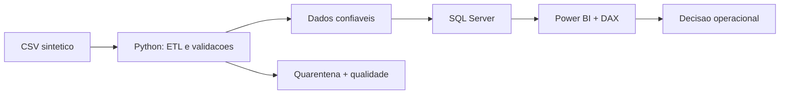

# Last Mile Analytics | Python + SQL Server + Power BI

**Projeto demonstrativo de ponta a ponta** para monitorar pontualidade de entregas, SLAs, transportadoras e centros de distribuição. Dados **100% sintéticos**, com problemas simulados de qualidade.

**Problema de negócio:** qual transportadora/CD deve receber prioridade para reduzir atrasos? A taxa isolada pode ocultar impactos absolutos; este projeto cruza taxa de pontualidade, volume, causa e tendência mensal.

## Stack
Python (pandas, NumPy, pytest) • SQL Server (CTE, LAG, ROW_NUMBER, views) • Power BI (DAX, modelagem, dashboards) • Git.

## Arquitetura



## Executar localmente
```powershell
python -m venv .venv
.venv\Scripts\activate
pip install -r requirements.txt
python -m src.generate_data
python -m src.pipeline
python -m pytest -q
```
No Linux/Mac, use `source .venv/bin/activate` em vez de `.venv\Scripts\activate`.

## Conteúdo
- `src/generate_data.py`: gerador reprodutível com `seed=42`, datas e falhas controladas.
- `src/pipeline.py`: validações, quarentena, indicadores e relatório de qualidade.
- `data/raw/entregas_raw.csv`: base fictícia com duplicidades e registros inválidos.
- `data/processed/fato_entregas.csv`: fato limpo para SQL/BI.
- `data/processed/entregas_rejeitadas.csv`: linhas excluídas, com motivo.
- `data/processed/qualidade.json`: contagem de linhas e indicador geral.
- `sql/`: DDL, importação de CSV, views e análises com CTE/Window Functions.
- `powerbi/`: medidas DAX e guia de modelagem/visuais. Após criar, versionar o projeto `.pbip`.
- `tests/`: testes automatizados do ETL.

## SQL Server (SSMS)
1. Execute `sql/01_schema.sql` para criar `PortfolioLastMile` e a tabela.
2. Ajuste o caminho do CSV em `sql/02_importar.sql` e execute. O serviço SQL Server deve conseguir ler o arquivo. Alternativa: use um assistente de importação SQL Server com tipos equivalentes.
3. Execute `sql/03_views_indicadores.sql` e `sql/04_analises.sql`.
4. Monte o dashboard seguindo `powerbi/GUIA_POWER_BI.md`.

## Carga automatizada opcional para SQL Server

Se preferir **evitar o `BULK INSERT`**, use Windows Authentication + ODBC Driver 18 for SQL Server (driver precisa estar instalado no Windows):

```powershell
pip install -r requirements-sqlserver.txt
python -m src.load_sqlserver --server "SEU_SERVIDOR\SUA_INSTANCIA"
```

Execute antes `sql/01_schema.sql` no SSMS; a carga é transacional e recusa tabelas já preenchidas (usar `--replace` para recarga intencional). O conector do Power BI lê os dados do SQL Server; o CI do GitHub Actions roda ETL + pytest a cada push.

Resultados de execução e exemplo de decisão: [`docs/RESULTADOS_EXEMPLO.md`](docs/RESULTADOS_EXEMPLO.md). Dicionário: [`docs/DICIONARIO_DADOS.md`](docs/DICIONARIO_DADOS.md).

## Indicadores e definições
| Indicador | Definição |
|---|---|
| On Time % | Entregas concluídas até a data/hora prometida ÷ entregas concluídas |
| Conclusão % | Entregas concluídas ÷ pedidos válidos |
| Entregas atrasadas | Concluídas fora do prazo |
| Lead Time médio | Horas de coleta até entrega, somente concluídas |
| Desvio de meta | On Time % menos meta ilustrativa de 95%, expresso em p.p. |

## Qualidade dos dados
Deduplicação por `id_entrega` (primeira ocorrência); checagem de status, obrigatoriedade, datas cronologicamente coerentes e valores positivos. Registros rejeitados vão para quarentena em vez de desaparecer silenciosamente. A ordenação sintética dos duplicados é determinística, mas em cenários reais seria preciso usar versão/timestamp de atualização.

## Limitações e próximos passos
Projeto de portfólio, não integração real com TMS/Comprovei. Etapas futuras: ingestão incremental, testes contratuais, orquestração, SCD de transportadoras e implantação agendada.

**Confidencialidade:** nenhuma informação real de empregadores, clientes, parceiros ou custos foi utilizada.
